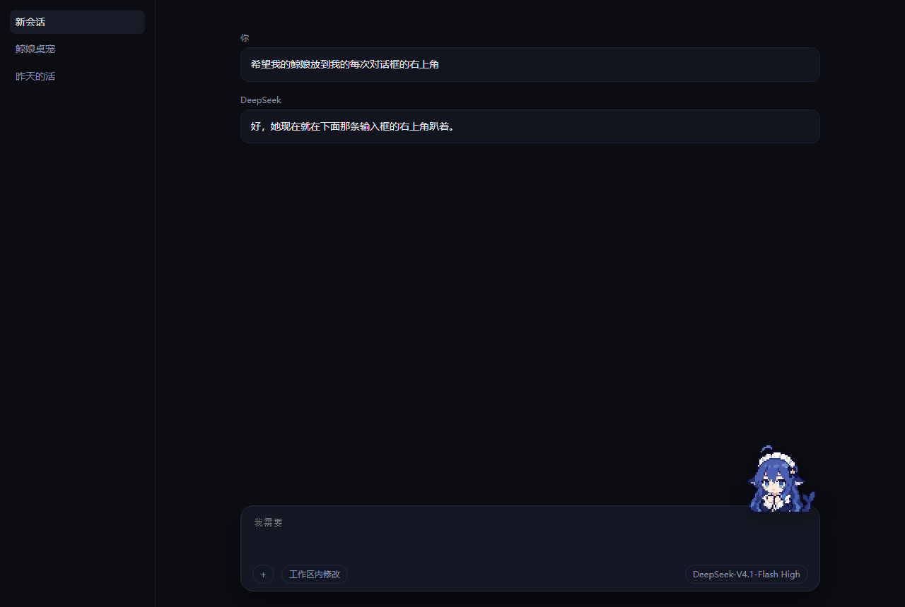

# 鲸娘 · DSH 输入框桌宠

把鲸娘放进 DeepSeek Harness 的对话界面：**贴在输入框右上角，脚踩框的顶边**，半个身子探在框外。输入框长高、窗口缩放、侧边栏开合她都跟着走；没有输入框的页面自动隐藏。

不改 DSH 源码，一个插件，随时可关。



> 截图是仿 DSH 的验证页面（`test/mock-server.mjs`），用来量位置，不是真实界面。

## 她做什么

| 对话在发生什么 | 她的反应 |
| --- | --- |
| 闲着 | 待机眨眼，每 11–24 秒随机东张西望 / 开心喷水 / 游来游去 / 冒爱心 / 举大拇指 |
| 你发了消息，她还在想 | 思考中 |
| 跑工具（1 个会话） | 敲代码 |
| 跑工具（2 个会话同时） | 戴耳机听歌 |
| 跑工具（3 个以上会话） | 施工中 |
| 工具报错 | 出错啦 |
| 这一轮做完 | 任务完成 → 随机冒爱心 / 举大拇指 |
| 上下文压缩 | 上下文清理 |
| 新建工作区 | 抱书搬运 |
| 待你点确认 | 需要你确认 |
| 60 秒没碰鼠标 | 呼呼大睡；一动就醒（被吵醒） |
| 点左脸 / 右脸 / 1 秒内连点 3 下 | 戳左边 / 戳右边 / 被挠痒痒 |

状态来自宿主的 `session/event` 与 `agent/assistant-stream`，不是猜 DOM。

## 素材要自己放（重要）

**本仓库不包含任何 GIF。** 那 22 个动画是别人画的，作者与授权情况以原始发布页为准：[鲸娘像素表情集](https://dshtui.com/pets/whale-girl-emoji/)。你确认自己有权使用后，把 22 个 GIF 放到下面任一位置：

1. `dsh-jingniang-pet/assets/`（推荐，仓库已 gitignore 这个目录）
2. 任意目录，然后用环境变量 `JINGNIANG_ASSETS` 指过去
3. `$DSH_HOME/jingniang-assets/`

文件名必须固定：

```
01-idle.gif            02-idle-look.gif       03-idle-spout.gif
04-thinking.gif        05-typing.gif          06-music.gif
07-conducting.gif      08-building.gif        09-error.gif
10-happy.gif           11-notification.gif    12-compacting.gif
13-carrying.gif        14-sleeping.gif        15-waking.gif
16-poke-left.gif       17-poke-right.gif      18-tickle.gif
19-drag.gif            20-swim.gif            21-smile-hearts.gif
22-thumbs-up.gif
```

`19-drag.gif` 用不到（网页里不做拖拽，会和「跟着输入框走」打架），但缺了也不影响，其余 21 个必须有。

素材原尺寸 552×528（69×66 逻辑像素放大 8 倍）。显示尺寸走整数倍缩放，默认 138 = 2 倍，像素不糊。

## 安装

先确认 DSH 版本 ≥ `0.2.1-rc.2`。

### 普通 profile

```powershell
dsh plugin --profile <你的 profile> add link:"<本仓库绝对路径>"
```

### 桌面版（DeepSeek Harness 客户端）

`dsh plugin` 对桌面版的 profile **会被拒绝**：`profile "desktop" is managed exclusively by the Electron application`。桌面版的 profile 只归应用自己管，得手动改四处：

1. `~/.dsh/profiles/desktop/package.json` → `dependencies` 加 `"dsh-jingniang-pet": "link:<本仓库绝对路径，正斜杠>"`（**别用 PowerShell 的 `Set-Content`，会写出 BOM 让 JSON 解析失败**）
2. 同一文件的 `dsh.profile.bundles` 加 `"dsh-jingniang-pet"`
3. `~/.dsh/profiles/desktop/pnpm-lock.yaml` 的 importer 里补对应条目，否则 lockfile 和 package.json 对不上：

   ```yaml
         dsh-jingniang-pet:
           specifier: link:<本仓库绝对路径，正斜杠>
           version: link:<本仓库绝对路径，正斜杠>
   ```

4. `~/.dsh/profiles/desktop/node_modules/dsh-jingniang-pet` 建 junction 指过来：

   ```powershell
   New-Item -ItemType Junction -Path "$env:USERPROFILE\.dsh\profiles\desktop\node_modules\dsh-jingniang-pet" -Target "<本仓库绝对路径>"
   ```

**改完必须重启 DSH 应用**，刷新页面没用。

### 卸载

把上面第 1、2 步那两行删掉，重启。或者更快：在 profile 的 `cordis.patch.yml` 里写

```yaml
- id: jingniang-pet
  disabled: true
```

## 右键菜单

大小 `138 / 207 / 276`、上下左右 4px 微调、归零、随机小动作开关、看锚点（用绿框把识别到的输入框标出来）、今天先藏。

改动写进 `~/.dsh/jingniang-pet.json`，重启后还在。

## 配置 `~/.dsh/jingniang-pet.json`

```json
{
  "enabled": true,
  "size": 138,
  "offsetX": 0,
  "offsetY": 0,
  "randomIdle": true,
  "sleepAfterSeconds": 60
}
```

`size` 建议用 138 / 207 / 276（2×/3×/4× 整数倍）。改完不用重启：宿主每次轮询都会把显示参数带给页面，一秒内生效。

## 位置不对怎么办

右键「看锚点」：绿框就是插件认的输入框。

- 框对了、人偏一点 → 「微调」挪，会存住
- 框本身就认错了 → 看 `/jingniang/debug` 里的 `geom`，它会告诉你 `how`（`card` / `fallback` / `self`）和那一层的 `tag`、`class`、坐标

## 排查

插件在宿主上注册了这几个只读接口（同源）：

| 路径 | 内容 |
| --- | --- |
| `/jingniang/config` | 当前配置 + 认到的素材目录（`assetDir` 为空就是没找到 GIF） |
| `/jingniang/phase` | 宿主认为她现在该干什么：`{"phase":"tool","toolSessions":1,...}` |
| `/jingniang/geom` | 页面报上来的锚点几何 |
| `/jingniang/debug` | 最近 80 个会话事件的原始类型 + 每个会话的相位 |

宿主日志里 `[jingniang-pet]` 开头的行会写挂载结果、素材目录、浏览器脚本语法检查结果。

## 实现

- `lib/index.js`（宿主）：注册 `/jingniang/*` 路由；把 `session/event`、`agent/assistant-stream` 投影成 7 个相位（`waiting/thinking/tool/review/done/failed` + 压缩/确认/搬运）；两条注入通道 —— 网页形态用 `webServer.tapIndex()` 改写 index.html，桌面形态用 `webserver/index-inject` 推一行内联 script，由它自己建 `<script src>` 并吞掉 onerror（路由没了也只是静默失败，绝不让宿主因为我们起不来）。
- `client/pet.js`（浏览器）：普通 DOM，零依赖，不碰 React。`position:fixed`，从 `textarea` 往上找「有圆角、有底色」的那层卡片当锚点，140ms 跟随一次；找不到就退到紧挨着输入框的那一层。
- 素材走宿主路由读盘，不打包进 JS。

## 测试

```powershell
# 宿主半边：路由、素材下发、相位投影、配置、两种注入通道，18 项
node test/smoke.mjs

# 浏览器半边：造一个仿 DSH 的页面，真跑脚本
node test/mock-server.mjs
#   http://127.0.0.1:8899/             正常
#   http://127.0.0.1:8899/?plain=1     卡片没有圆角/底色，验证兜底分支
#   http://127.0.0.1:8899/?phase=tool  预置状态
```

`test/probe.mjs` 用 CDP 连无头 Edge 量真实坐标（`CDP_PORT` 环境变量指定调试端口）。

## 授权

代码 MIT，见 `LICENSE`。**GIF 素材不在授权范围内，仓库也不分发**，请自行取得使用许可。
